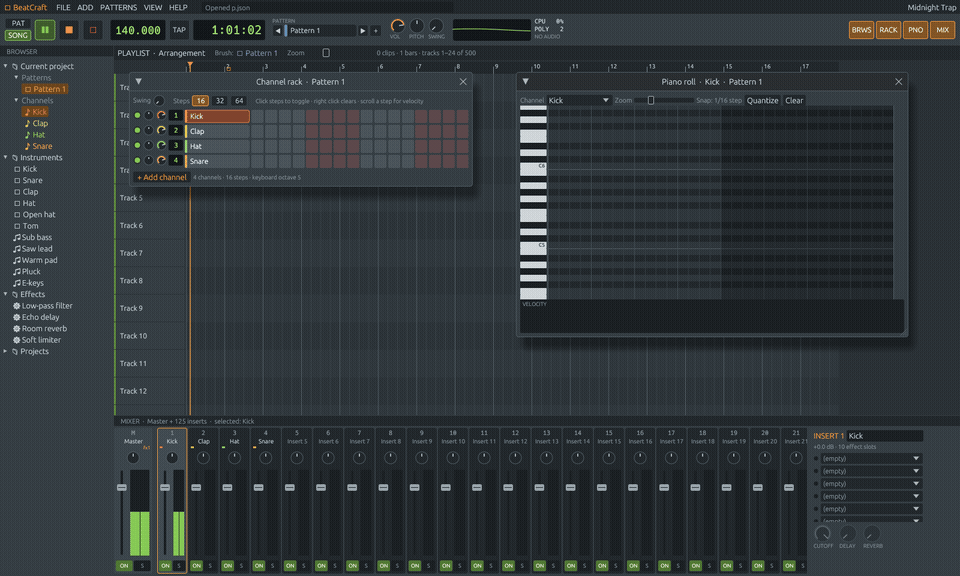
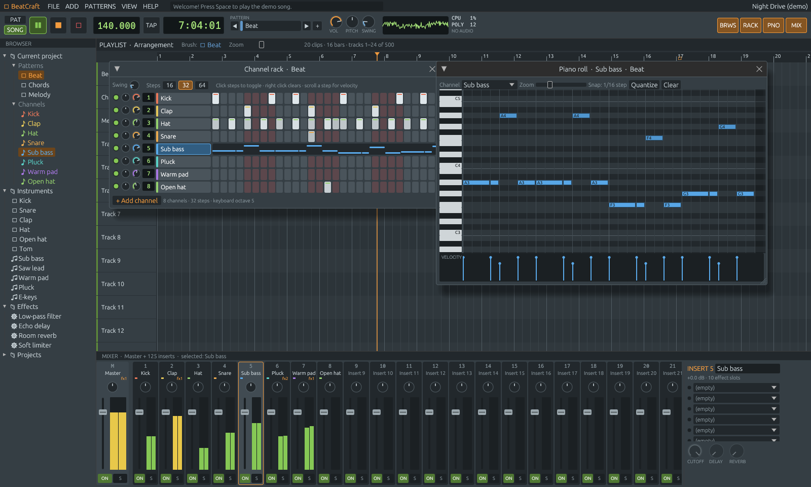

<p align="center">
  
</p>

<h1 align="center">BeatCraft</h1>

<p align="center">
  <b>Pattern-based beat making: an open-source step sequencer, piano roll, playlist and mixer, built in pure Rust.</b><br>
  Light up steps, draw melodies, arrange patterns into a song and mix it, in a native app with
  built-in instruments and effects. Every change is also a command that the CLI and AI agents (through MCP) can run.
</p>

<p align="center">
  <b>Tell your AI assistant "make me a 140 BPM trap beat", and it builds it in BeatCraft.</b><br>
  <a href="https://mustafayusufyalcin.github.io/beatcraft/">Try it in your browser</a> ·
  runs natively on macOS, Windows and Linux
</p>

<p align="center">
  By Mustafa Yusuf Yalçın and Yusuf Arslan · an independent community app that follows the Craft app conventions
</p>

> [!NOTE]
> BeatCraft is an **independent community project**. It is not made or maintained by ArtCraft,
> and it is not affiliated with any other music software or its publisher.

<p align="center">
  <a href="#what-works-today">What works</a> ·
  <a href="#getting-started">Getting started</a> ·
  <a href="#agents-cli-and-mcp">Agents, CLI and MCP</a> ·
  <a href="docs/wiki/Home.md">Docs</a> ·
  <a href="#roadmap">Roadmap</a> ·
  <a href="#contributing">Contributing</a> ·
  <a href="#downloads">Downloads</a> ·
  <a href="#license">License</a>
</p>



<sub>The beat above was built only with commands, the same ones an AI agent sends over MCP:
[examples/trap-beat.sh](examples/trap-beat.sh).</sub>



## What works today

BeatCraft is **early alpha**. Today it can:

- **Sequence:** a channel rack with 16, 32 or 64 steps per pattern, per-step velocity, swing in
  whole-percent steps, mute, volume and pan per channel.
- **Write melodies:** a piano roll with drawing, moving, resizing and deleting notes, a velocity
  lane, ghost notes from other channels and quantize.
- **Arrange:** a playlist with pattern clips you place, move, stretch and delete; pattern and song mode.
- **Mix:** Master, 125 inserts and a Current track, ten effect slots per track, faders, pan, mute
  and solo, live meters; built-in low-pass filter, ping-pong delay, room reverb and soft limiter.
- **Make sound:** eleven built-in instruments (kick, snare, clap, hats, tom, sub bass, saw lead,
  pad, pluck, e-keys), all synthesised; play the selected channel from the computer keyboard.
- **Save and share:** projects as `.beatcraft.json`, the song rendered to a 44.1 kHz WAV file.
- **Automate:** 19 commands from the CLI and an MCP server.
- **Run anywhere:** native on macOS, Windows and Linux, and in the browser (WebAssembly).

Not yet: audio recording, sample loading, automation clips, undo, MIDI input, plugins.

## Getting started

```sh
git clone https://github.com/MustafaYusufYalcin/beatcraft
cd beatcraft
cargo run --release --bin BeatCraft
```

Open a saved project directly with `BeatCraft my-beat.beatcraft.json`. Needs a recent stable Rust. On Linux install the ALSA and windowing headers first
(Debian/Ubuntu: `sudo apt install libasound2-dev libx11-dev libxcursor-dev libxrandr-dev libxi-dev libxkbcommon-dev libwayland-dev libgl1-mesa-dev`).

| Key | Does |
|---|---|
| Space | Play / pause |
| L | Pattern / song mode |
| F6 F7 F8 F9 | Channel rack, piano roll, browser, mixer |
| Z S X D C … / Q 2 W 3 E … | Play the selected channel |
| − / = | Keyboard octave |
| Ctrl/Cmd + S | Save |

**In the browser:** `rustup target add wasm32-unknown-unknown`, install [trunk](https://trunkrs.dev),
then `trunk serve --release` and open http://127.0.0.1:8080. Click the page once to let the browser
start sound. The web build cannot save projects to disk yet.

## Agents, CLI and MCP

`beatcraft-cli` runs the same project engine without a window:

```sh
beatcraft-cli list                                             # every command and its parameters
beatcraft-cli run beat.json project.set_tempo '{"bpm": 128}'
beatcraft-cli run beat.json step.fill '{"pattern": 0, "channel": 0, "every": 4}'
beatcraft-cli run beat.json clip.add '{"pattern": 0, "track": 0, "bar": 0, "bars": 4}'
beatcraft-cli render beat.json beat.wav
```

`beatcraft-cli mcp` is a Model Context Protocol server on stdio with the tools `list_commands`,
`execute`, `batch`, `inspect_project`, `open_project`, `save_project` and `export_wav`.
Claude Code: `claude mcp add beatcraft -- beatcraft-cli mcp`, then ask for a beat.
[examples/trap-beat.sh](examples/trap-beat.sh) shows a whole beat built from these commands.
The [command reference](docs/wiki/Command-Reference.md) describes every command, and
[MCP setup](docs/wiki/MCP-Setup.md) shows how to connect an AI assistant.

## Documentation

The wiki lives in [docs/wiki](docs/wiki/Home.md):
[Getting started](docs/wiki/Getting-Started.md),
[Your first beat](docs/wiki/Your-First-Beat.md),
[Command reference](docs/wiki/Command-Reference.md),
[MCP setup](docs/wiki/MCP-Setup.md),
[Project file format](docs/wiki/Project-File-Format.md),
[Architecture](docs/wiki/Architecture.md),
[Sound engine](docs/wiki/Sound-Engine.md),
[Testing](docs/wiki/Testing.md),
[Releasing](docs/wiki/Releasing.md) and
[FAQ](docs/wiki/FAQ.md).

## Roadmap

1. Route every button in the app through the command layer, plus a JSON control channel to drive the running window.
2. Sample channels (WAV/FLAC/MP3), undo, automation clips.
3. MIDI input, audio recording, CLAP plugins.
4. Saving and loading projects in the browser build.

## Contributing

Pull requests are welcome, and you don't need to know audio programming to help: new instruments,
effects, themes, translations and docs are all open. Start with an issue labelled
**good first issue** and read [CONTRIBUTING.md](CONTRIBUTING.md).

## Downloads

Builds are attached to each [GitHub release](https://github.com/MustafaYusufYalcin/beatcraft/releases),
with a `SHA256SUMS.txt` to check them against: a `.dmg` for macOS (`beatcraft-<version>-macos-universal.dmg`),
a portable `.zip` for Windows (`beatcraft-<version>-windows-x64-portable.zip`), and an `.AppImage` or a `.tar.gz`
with an `install.sh` for Linux. `beatcraft-cli` has its own zip on macOS and is inside the Windows and Linux packages.
See [PACKAGING.md](PACKAGING.md) to build them yourself. macOS builds are not notarised yet
(right-click → Open the first time); Windows builds are unsigned (SmartScreen → More info → Run anyway).

## License

BeatCraft is dual-licensed under [MIT](LICENSE-MIT) or [Apache-2.0](LICENSE-APACHE), at your option.
Copyright (c) 2026 Mustafa Yusuf Yalçın, Yusuf Arslan and the BeatCraft contributors.
Required notices are in [NOTICE](NOTICE). The app icon is drawn in code and every sound is
synthesised by BeatCraft itself; see [ATTRIBUTION.md](ATTRIBUTION.md). Maintainers are listed in
[MAINTAINERS.md](MAINTAINERS.md).
Where the design numbers come from, and what changed in 0.2.0, is in
[docs/PROVENANCE.md](docs/PROVENANCE.md).
