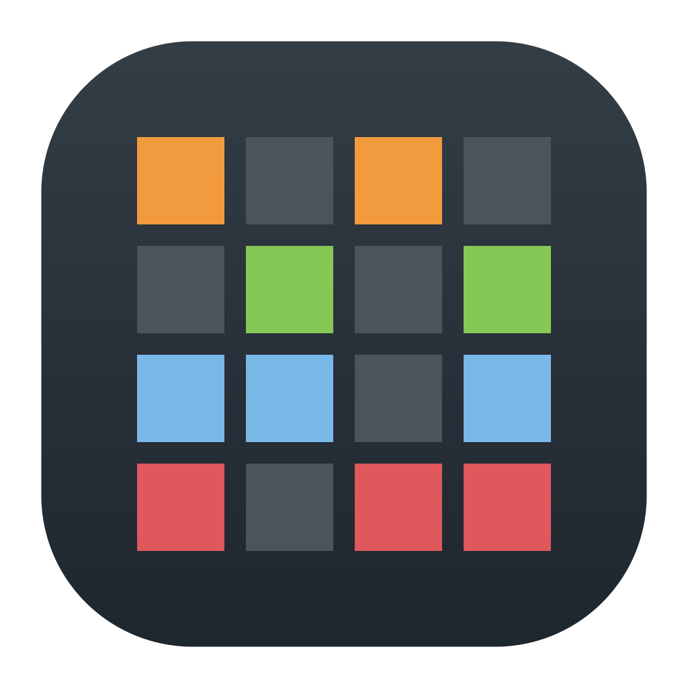

<p align="center">
  
</p>

<h1 align="center">BeatCraft</h1>

<p align="center">
  <b>Pattern-based beat making: an open-source step sequencer, piano roll, playlist and mixer, built in pure Rust.</b><br>
  Light up steps, draw melodies, arrange patterns into a song and mix it, in a native app with
  built-in instruments and effects. Every change is also a command that the CLI and AI agents (through MCP) can run.
</p>

<p align="center">
  By Mustafa Yusuf Yalçın and &lt;ARKADAŞ ADI SOYADI&gt; · a community app in the Craft ecosystem
</p>

> [!NOTE]
> BeatCraft is an **independent community project**. It is not made or maintained by ArtCraft,
> and it is not affiliated with any other music software or its publisher.

<p align="center">
  <a href="#what-works-today">What works</a> ·
  <a href="#getting-started">Getting started</a> ·
  <a href="#agents-cli-and-mcp">Agents, CLI and MCP</a> ·
  <a href="#roadmap">Roadmap</a> ·
  <a href="#downloads">Downloads</a> ·
  <a href="#license">License</a>
</p>


## What works today

BeatCraft is **early alpha**. Today it can:

- **Sequence:** a channel rack with 16, 32 or 64 steps per pattern, per-step velocity, swing in
  1/128 steps, mute, volume and pan per channel.
- **Write melodies:** a piano roll with drawing, moving, resizing and deleting notes, a velocity
  lane, ghost notes from other channels and quantize.
- **Arrange:** a playlist with pattern clips you place, move, stretch and delete; pattern and song mode.
- **Mix:** Master, 125 inserts and a Current track, ten effect slots per track, faders, pan, mute
  and solo, live meters; built-in low-pass filter, ping-pong delay, room reverb and soft limiter.
- **Make sound:** eleven built-in instruments (kick, snare, clap, hats, tom, sub bass, saw lead,
  pad, pluck, e-keys), all synthesised; play the selected channel from the computer keyboard.
- **Save and share:** projects as `.beatcraft.json`, the song rendered to a 44.1 kHz WAV file.
- **Automate:** 19 commands from the CLI and an MCP server.

Not yet: audio recording, sample loading, automation clips, undo, MIDI input, plugins.

## Getting started

```sh
git clone https://github.com/MustafaYusufYalcin/beatcraft
cd beatcraft
cargo run --release --bin BeatCraft
```

Needs a recent stable Rust. On Linux install the ALSA and windowing headers first
(Debian/Ubuntu: `sudo apt install libasound2-dev libx11-dev libxcursor-dev libxrandr-dev libxi-dev libxkbcommon-dev libwayland-dev libgl1-mesa-dev`).

| Key | Does |
|---|---|
| Space | Play / pause |
| L | Pattern / song mode |
| F6 F7 F8 F9 | Channel rack, piano roll, browser, mixer |
| Z S X D C … / Q 2 W 3 E … | Play the selected channel |
| − / = | Keyboard octave |
| Ctrl/Cmd + S | Save |

## Agents, CLI and MCP

`beatcraft-cli` runs the same project engine without a window:

```sh
beatcraft-cli list                                             # every command and its parameters
beatcraft-cli run beat.json project.set_tempo '{"bpm": 128}'
beatcraft-cli run beat.json step.fill '{"pattern": 0, "channel": 0, "every": 4}'
beatcraft-cli run beat.json clip.add '{"pattern": 0, "track": 0, "bar": 0, "bars": 4}'
beatcraft-cli render beat.json beat.wav
```

`beatcraft-cli mcp` is a Model Context Protocol server on stdio with the tools `list_commands`,
`execute`, `batch`, `inspect_project`, `open_project`, `save_project` and `export_wav`.
Claude Code: `claude mcp add beatcraft -- beatcraft-cli mcp`.

## Roadmap

1. Route every button in the app through the command layer, plus a JSON control channel to drive the running window.
2. Sample channels (WAV/FLAC/MP3), undo, automation clips.
3. MIDI input, audio recording, CLAP plugins.
4. A browser build (WebAssembly).

## Downloads

Builds for macOS, Windows and Linux are attached to each
[GitHub release](https://github.com/MustafaYusufYalcin/beatcraft/releases), with a `SHA256SUMS.txt` to check them against.
See [PACKAGING.md](PACKAGING.md) to build them yourself. macOS builds are not notarised yet
(right-click → Open the first time); Windows builds are unsigned (SmartScreen → More info → Run anyway).

## License

BeatCraft is dual-licensed under [MIT](LICENSE-MIT) or [Apache-2.0](LICENSE-APACHE), at your option.
Copyright (c) 2026 Mustafa Yusuf Yalçın, &lt;ARKADAŞ ADI SOYADI&gt; and the BeatCraft contributors.
Required notices are in [NOTICE](NOTICE). The app icon is drawn in code and every sound is
synthesised by BeatCraft itself; see [ATTRIBUTION.md](ATTRIBUTION.md). Maintainers are listed in
[MAINTAINERS.md](MAINTAINERS.md).
